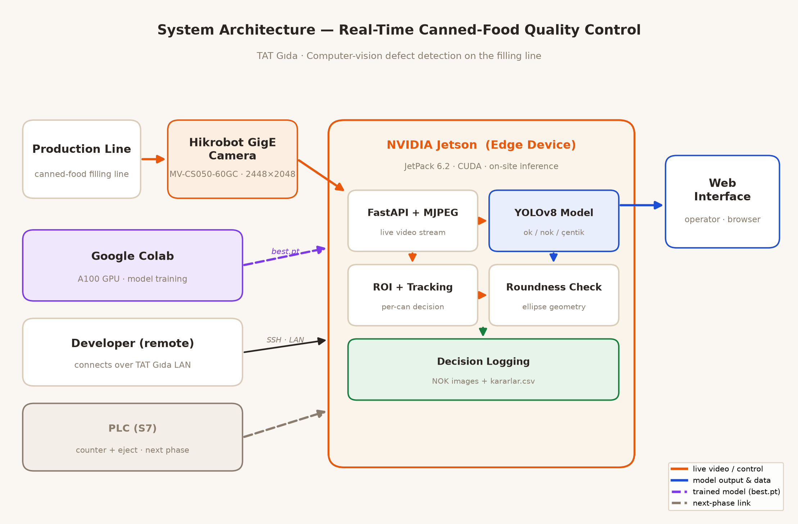
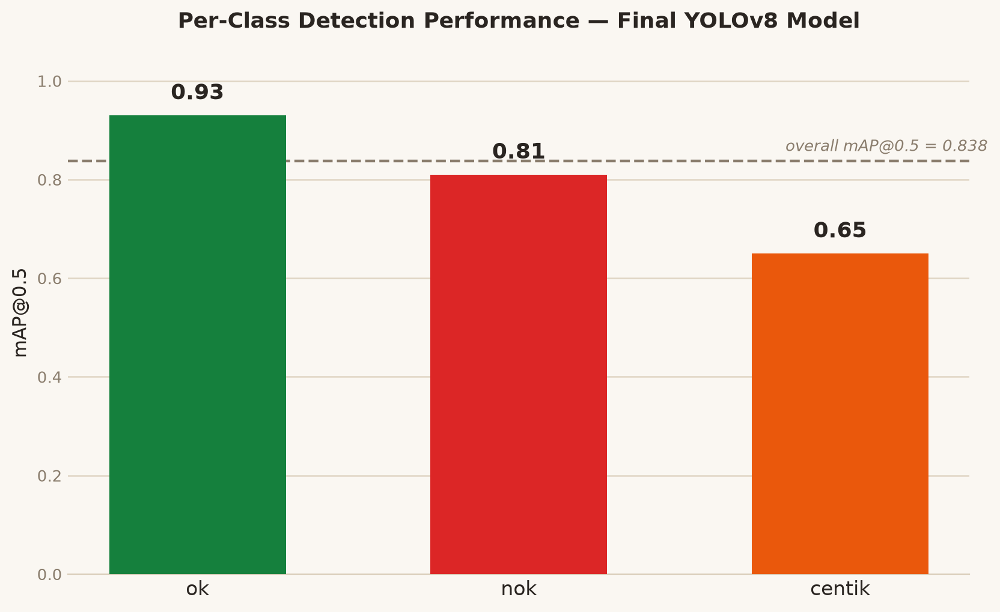

# Real-Time Quality Control for a Canned-Food Production Line

A computer-vision system that inspects canned-food containers on a live filling line and reaches an accept/reject decision for every single can, in real time, directly at the line.

Developed during a 20-working-day engineering internship at **TAT Gıda** (Adana, Turkey) for the Department of Computer Engineering, **Çukurova University** — 29 June – 27 July 2026.

---

## The Problem

On the filling line, cans are checked by hand for deformation, dents, out-of-roundness and lid-seating defects. Manual inspection is slow, inconsistent between operators, and cannot keep up with the speed of the line. The objective was to detect these defects automatically and in real time, without sending any production imagery outside the plant.

## System Architecture



An **NVIDIA Jetson** installed at the line runs the entire pipeline on-premise: it acquires frames from an industrial GigE camera, performs inference, decides per can, and serves a live web interface to the quality-control operator. Model training is performed off-device on a cloud GPU, and only the resulting weights are deployed back to the Jetson. Production images never leave the plant network.

A deliberate architectural rule shaped the codebase: **the backend never knows which concrete camera or PLC is attached.** Both sit behind abstract interfaces and are selected purely through configuration. This allowed the same code to run unchanged against a development webcam and against the production camera on the line.

## How It Works

| Stage | Implementation |
| --- | --- |
| **Acquisition** | Hikrobot MV-CS050-60GC GigE Vision camera (2448×2048, Mono8) through the MVS SDK — device discovery by IP, optimal GigE packet size, continuous grabbing, conversion to BGR |
| **Detection** | YOLOv8 trained on three classes: `ok`, `nok`, `çentik` (dent) |
| **Evaluation zone** | A configurable Region of Interest — a can is judged only while fully inside the zone, where lighting and viewing angle are most consistent |
| **Tracking** | ByteTrack assigns a stable ID to each can, so detections across consecutive frames are known to belong to the same physical object and each can is decided exactly once |
| **Decision** | Multi-frame voting: a can is rejected only when it is detected as defective in at least *N* frames, so a single noisy frame cannot flip the verdict |
| **Geometric check** | Otsu thresholding + ellipse fitting; the major/minor axis ratio independently flags out-of-round cans, backing up the learned model with a direct measurement |
| **Traceability** | Every rejected can is archived as an image, and every decision is written to a CSV log with timestamp, verdict and reason |

## Engineering Highlights

**Motion blur was a physics problem, not a software one.** Fast-moving cans came out smeared. Investigation showed the scene was too dark, forcing a ~23 ms exposure during which a can travels a visible distance. Shorter exposures reduced blur but left the image too dark for the sensor's limited gain to compensate. The fix was at the source: strong fixed industrial lighting was added to the station, which allowed the exposure to be lowered significantly and the gain retuned, producing sharp frames of fast-moving cans.

**CPU inference could not keep up.** Running the model on the Jetson's CPU yielded only a couple of frames per second. Moving inference to the GPU required a CUDA-enabled PyTorch build matching the JetPack version, and resolving a missing `cuDSS` dependency from the vendor's redistributable package. After the fix, inference ran on the GPU with enough headroom to restore full-resolution inference.

**Reliability over raw accuracy.** On a moving line, a per-frame classifier is not enough. The ROI, the tracker and the multi-frame voting rule exist so that one bad frame never produces a wrong verdict — and so that the same can is never counted twice.

## Results



- **Dataset:** ~3,500 images collected from the live production line and hand-labelled in YOLO format across three classes
- **Overall mAP@0.5: 0.838**
- Per class — `ok` 0.93 · `nok` 0.81 · `çentik` 0.65
- Runs in real time on the Jetson at the line's operating speed

The remaining confusion is concentrated between `ok` and `nok`, which is also the hardest distinction visually; `çentik` detection is comparatively weaker and would benefit most from additional labelled examples.

## Tech Stack

`Python` · `FastAPI` · `Uvicorn` · `OpenCV` · `Ultralytics YOLOv8` · `PyTorch (CUDA)` · `ByteTrack` · `NVIDIA Jetson (JetPack 6.2)` · `Hikrobot MVS SDK` · `python-snap7`

## Repository Contents

This repository holds the application framework built for the project:

```
app/
  main.py          FastAPI routes — live stream, status, camera control, snapshot
  state.py         application state, capture thread, frame-processing pipeline
  config.py        all settings, overridable via environment variables
  camera/
    base.py        camera interface
    webcam.py      development source (OpenCV VideoCapture)
    hikrobot.py    production source (Hikrobot GigE via MVS SDK)
  plc/
    base.py        PLC interface
    mock.py        simulated counter for development
    snap7_client.py  Siemens S7-1500 client
templates/, static/  operator web interface
docs/                architecture and results figures
```

The detection module and the trained model weights run on the on-premise Jetson device and are not part of this public repository: the model was trained on TAT Gıda production imagery, which is company property.

## Getting Started

```bash
python3 -m venv venv
source venv/bin/activate
pip install -r requirements.txt

python -m uvicorn app.main:app --host 0.0.0.0 --port 8000
```

Then open <http://localhost:8000>. By default the application starts with a standard webcam, so it runs on any machine without industrial hardware attached.

To run against the industrial camera (Linux, MVS SDK installed):

```bash
export LD_LIBRARY_PATH=/opt/MVS/lib/aarch64:$LD_LIBRARY_PATH
export MVCAM_COMMON_RUNENV=/opt/MVS/lib
CAMERA_SOURCE=hikrobot HIKROBOT_IP=<camera-ip> \
  python -m uvicorn app.main:app --host 0.0.0.0 --port 8000
```

## Configuration

Every setting is read from the environment with a sensible default, so no code change is needed between development and the line.

| Variable | Default | Description |
| --- | --- | --- |
| `CAMERA_SOURCE` | `webcam` | `webcam` or `hikrobot` |
| `CAMERA_INDEX` | `0` | webcam device index |
| `HIKROBOT_IP` | — | IP address of the industrial camera |
| `FRAME_WIDTH` / `FRAME_HEIGHT` | `1280` / `720` | capture resolution |
| `TARGET_FPS` | `25` | target streaming frame rate |
| `JPEG_QUALITY` | `80` | MJPEG stream quality |
| `PLC_ENABLED` | `false` | enable the Siemens S7 client |
| `PLC_IP` | `192.168.0.1` | PLC address |
| `CAPTURE_DIR` | `data` | where captured frames are written |

## Roadmap

- PLC integration for physically ejecting rejected cans from the line
- Classifying the specific defect type instead of a binary verdict
- TensorRT export for additional inference throughput
- Expanding the dataset, in particular for the `çentik` class

## Acknowledgements

Academic advisor: Doç. Dr. Yusuf Kuvvetli · Industry advisor: Çiğdem Şahin — and the TAT Gıda engineering team for their support throughout the internship.
